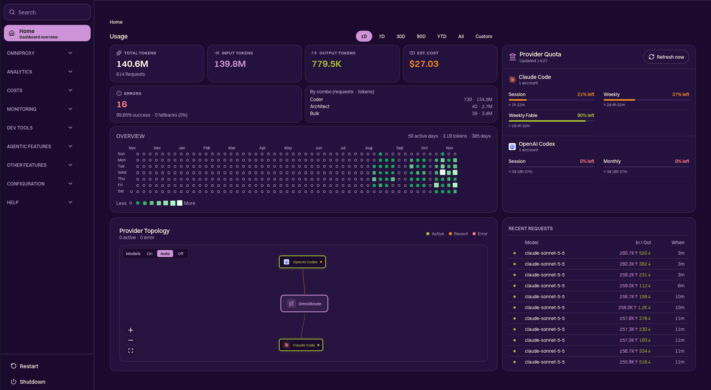

# OmniRoute

OmniRoute is a local AI gateway: one OpenAI-compatible endpoint (`/v1`) in front of 394 providers,
with combos (ordered fallback chains), quota tracking, compression, MCP and A2A.
This repository is a fork of [cheaper-inference/OmniRoute](https://github.com/cheaper-inference/OmniRoute).

This README only covers what this fork changes and how to run it. For everything else
(providers, routing strategies, CLI, deployment) see the [`docs/`](docs/) folder.
The full upstream README is kept as [`docs/ORIGINAL_README.md`](docs/ORIGINAL_README.md).

## What this fork changes

The `/home` dashboard page now shows usage at a glance, without opening Analytics.



| Area                 | Change                                                                                                                                    |
| -------------------- | ----------------------------------------------------------------------------------------------------------------------------------------- |
| Usage block          | Total, input and output tokens, estimated cost, errors with success and fallback rate, and the activity heatmap. Same cards as Analytics. |
| Range selector       | 1D, 7D, 30D, 90D, YTD, All and Custom (reuses the Analytics range picker).                                                                |
| Usage by combo       | Requests and tokens per combo for the selected range. New endpoint `GET /api/usage/by-combo`.                                             |
| Trend                | The token and cost cards show the change against the previous period of the same length ("+12% vs. previous period"). Not shown for All.  |
| Loading and errors   | A skeleton while the first response loads, and a Retry button when it fails.                                                              |
| Provider quotas      | Quota card next to the usage block for every provider with quota tracking, showing every quota row (no "show more" toggle).               |
| Quota scrolling      | The card fills the height of the usage block and scrolls inside it one whole page of providers at a time, so none is ever cut in half.    |
| Active only          | Only active connections appear, the same rule as the topology. Deactivated ones are hidden.                                               |
| Account labels       | The connection name is shown. An email is hidden unless the email visibility setting allows it, and the quota bars are progress bars.     |
| Layout               | Quick Start comes first, then usage and quota side by side. All home blocks and the cards inside them share one 12px gap.                 |
| Show or hide         | Three new switches in Settings > Appearance > "Pin Information to Home Page" (see below). All are on by default.                          |
| Removed from `/home` | The host CPU and memory cards (the component still exists, it is just not mounted).                                                       |

### Home switches

Settings > Appearance > "Pin Information to Home Page" next to the existing Quick Start and Provider Topology switches:

| Setting                     | Shows or hides                                                                   |
| --------------------------- | -------------------------------------------------------------------------------- |
| `showUsageStatsOnHome`      | The usage cards and the range selector. When off, `/home` does not fetch usage.  |
| `showActivityHeatmapOnHome` | The activity heatmap. Disabled while the usage cards are off.                    |
| `showProviderQuotaOnHome`   | The provider quota card. It stays visible on its own if the usage cards are off. |

A missing setting counts as "show", so a fresh install looks the same as before. The page reads
them on the server: reload `/home` after changing one.

### Sticky palette

A third colour palette next to Editions and Classic, selectable in Settings > Appearance > Color
palette. It is opt-in: Editions stays the default.

- Light: warm paper background, ink text and a purple accent. Dark: night plum background, paper text and a lighter purple for fills and links.
- Success, warning, error and info use lime, orange, red and blue. The text shades were darkened to keep at least 4.5:1 contrast.
- Rounder corners (controls 0.75rem, surfaces 1rem) and soft purple-tinted shadows.
- It only applies under `data-ci-appearance="sticky"`, so the other palettes are untouched.
- The tokens live in `src/app/sticky-palette.css`, imported from `globals.css`.

Charts use 8 colours derived from the palette, which has no categorical set of its own. Check
them on your screens before relying on them.

### New endpoint

```
GET /api/usage/by-combo?range=1d|7d|30d|90d|ytd|all|custom[&startDate=ISO&endDate=ISO]
```

Requires management authentication. `custom` needs `startDate`. Response:

```json
{
  "range": "1d",
  "combos": [
    {
      "comboName": "coder",
      "requests": 703,
      "successCount": 690,
      "inputTokens": 190500000,
      "outputTokens": 900000
    }
  ]
}
```

Calls without a combo are ignored. Upstream HTTP attempts are not counted as extra requests.

### Changed files

- `src/app/(dashboard)/home/HomeUsageWidgets.tsx` (new): the usage block, with `showStats` and `showHeatmap` props, the trend, the skeleton and the retry button.
- `src/app/(dashboard)/home/usageTrend.ts` and `quotaPaging.ts` (new): the previous-period window and the whole-page packing of the quota card.
- `src/app/(dashboard)/home/page.tsx` and `loadHomeSettings.ts`: read the three switches on the server and mount the usage block with the quota card as `aside`.
- `src/app/(dashboard)/home/ProviderQuotaWidget.tsx`: new optional `providers` filter and `showAllQuotas` props; skips deactivated connections and hides account emails.
- `src/app/(dashboard)/dashboard/settings/components/AppearanceTab.tsx`, `src/shared/validation/settingsSchemas.ts`: the three switches and the Sticky palette option.
- `src/app/sticky-palette.css` (new), `src/app/globals.css`, `src/shared/constants/appearancePalette.ts`, `pwaThemeColors.ts`, `src/store/themeStore.ts`, `src/shared/utils/themeBootScript.ts`, `src/app/global-error.tsx`: the Sticky palette.
- `.github/workflows/fork-build.yml` and `fork-sync.yml` (new): the build and sync workflows (see below).
- `src/app/(dashboard)/home/ProviderTopology.tsx`, `HomeRecentRequests.tsx` and `dashboard/HomePageClient.tsx`: shorter panels with matching height.
- `src/app/api/usage/by-combo/route.ts` and `src/lib/db/comboUsageSummary.ts` (new): the by-combo endpoint and its query.
- `src/i18n/messages/en.json` and `es.json`: new `home` and palette keys. Other locales fall back to English.
- Tests: `tests/unit/usage-by-combo.test.ts`, `tests/unit/ui/home-usage-widgets.test.tsx`, `tests/unit/ui/provider-quota-show-all-quotas.test.tsx`, `tests/unit/appearance-widget-settings-schema.test.ts` and `tests/unit/theme-boot-script-palette.test.ts`.

## Get the build without compiling

GitHub Actions builds the package, so you do not need to run `npm run build` on your machine.

- **`fork-build.yml`** runs on every push to `release/v*` (or by hand). It runs `npm run build:release`, packs the result with `npm pack` and publishes it as the release `fork-v<version>-<run>`. It also refreshes the rolling release `fork-latest`.
- **`fork-sync.yml`** runs daily (05:17 UTC) or by hand. It finds the newest `release/vX.Y.Z` of the upstream repository. If the fork's branch of that name does not contain it, it merges upstream into a temporary branch, opens a pull request and merges it. For a new release it creates the branch from upstream and merges the previous fork release into it. A conflict other than `README.md` aborts and opens an issue. It needs the secret `FORK_SYNC_TOKEN` (a personal access token with Contents, Pull requests and Workflows write access).

Install the latest build:

```bash
curl -L -o omniroute.tgz \
  https://github.com/Sticky0/OmniRoute/releases/download/fork-latest/omniroute-latest.tgz
npm install --prefix ~/.local/share/omniroute-fork ./omniroute.tgz
node ~/.local/share/omniroute-fork/node_modules/omniroute/bin/omniroute.mjs
```

Restart whatever runs it (for example a systemd user service) after installing. `dist/BUILD_SHA`
inside the package is the commit it was built from.

## Repository rules

Two rulesets protect the fork. Both let the repository admin bypass them.

- **No direct pushes** (every branch): no branch deletion, no force push, changes only through a pull request.
- **Release needs PR and approval** (`release/**`): a pull request with one approval, code owner review, resolved conversations, and stale approvals dismissed on new pushes.

`.github/CODEOWNERS` names the fork owner. Merged branches are deleted automatically. With a single
collaborator nobody else can approve, so the admin bypass is how pull requests get merged.

## Requirements

Node.js `>=22.22.2 <23` or `>=24.0.0 <27` (see `engines` in `package.json`).

## Run it

```bash
cp .env.example .env
npm install
npm run dev          # development server, default port 20128
```

Production-style run from the sources:

```bash
npm run build        # Next.js standalone build
npm run build:cli    # assembles dist/, which the CLI serves
node bin/omniroute.mjs
```

`npm run build` is memory hungry. On a machine with limited RAM, cap it with
`OMNIROUTE_BUILD_MEMORY_MB` and prefer webpack (`OMNIROUTE_USE_TURBOPACK=0`). Both variables
are documented in [`docs/reference/ENVIRONMENT.md`](docs/reference/ENVIRONMENT.md).

## Test

```bash
# Endpoint (Node test runner)
node --import tsx/esm --import ./open-sse/utils/setupPolyfill.ts \
  --import ./tests/_setup/isolateDataDir.ts --test tests/unit/usage-by-combo.test.ts

# UI (Vitest)
npx vitest run --config vitest.config.ts \
  tests/unit/ui/home-usage-widgets.test.tsx \
  tests/unit/ui/provider-quota-show-all-quotas.test.tsx

# Settings schema and palette boot script (Node test runner)
node --import tsx --test \
  tests/unit/appearance-widget-settings-schema.test.ts \
  tests/unit/theme-boot-script-palette.test.ts

npm run lint
```

The dashboard type check (`tsconfig.typecheck-dashboard.json`) already reports errors that are
unrelated to these changes.

## Documentation

- [Contributing](CONTRIBUTING.md)
- [Environment variables](docs/reference/ENVIRONMENT.md)
- [Docker guide](docs/guides/DOCKER_GUIDE.md)
- [Architecture](docs/architecture/)
- [Changelog](CHANGELOG.md) · [Roadmap](ROADMAP.md) · [Security](SECURITY.md)

## License

MIT, see [LICENSE](LICENSE). Original work by the OmniRoute authors; this fork keeps their license
and copyright notice.
